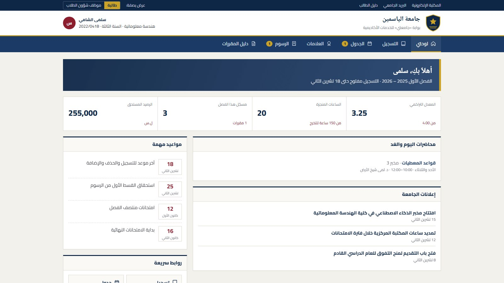

<div align="center">

# جامعتي · Jamiaty

**University management system: registration, sections, grades and fees**

[](https://abdulhadi.review/#demo/jamiaty) [](https://abdulhadi.review)

`React` · `TypeScript` · `Vite` · `CSS Modules` · `Figma`



</div>

---

<div dir="rtl" align="right">

## عن المشروع

**نظام إدارة جامعي** · 2025

نظام ويب لشؤون الطلاب يجمع التسجيل الفصلي، الشعب والجداول، الامتحانات والرسوم في لوحة واحدة للمسجّل، مع بوابة للطالب يتابع منها مقرراته وعلاماته.

**المشكلة:** التسجيل الفصلي يجري على جداول متفرقة وطوابير أمام شؤون الطلاب، فتتأخر الموافقات وتُكتشف تعارضات الجدول بعد بدء الدوام.

**الحل:** تسجيل إلكتروني يتحقق من المتطلبات السابقة وسعة الشعبة وتعارض المواعيد لحظة الطلب، ولوحة تعرض للمسجّل ما ينتظر قراره فقط.

### أبرز المزايا

- تسجيل المقررات مع كشف فوري لتعارض المواعيد والمتطلبات
- إدارة الشعب والقاعات والجدول الأسبوعي
- رصد العلامات وكشوف الطلاب بصلاحيات حسب الدور
- متابعة الرسوم والأقساط وإيصالات الدفع
- تقارير القبول والتسجيل لكل قسم وفصل

</div>

---

## Run locally

```bash
npm install
npm run dev        # http://localhost:5173
npm run build      # type-check and build to dist/
```

An interactive prototype from my portfolio. Demo data is generated in the browser and saved to localStorage only.


---

Designed and built by **Abdulhadi Almohammad** ([@abood352](https://github.com/abood352)) · [abdulhadi.review](https://abdulhadi.review)
